# AI-Based Customer Support Ticket Classification & Priority Prediction System

An AI-assisted support-ticket triage system that classifies customer issues into departments, predicts handling priority, recommends an SLA, explains each decision, and flags low-confidence predictions for human review.


-brightgreen)


---

## Demo

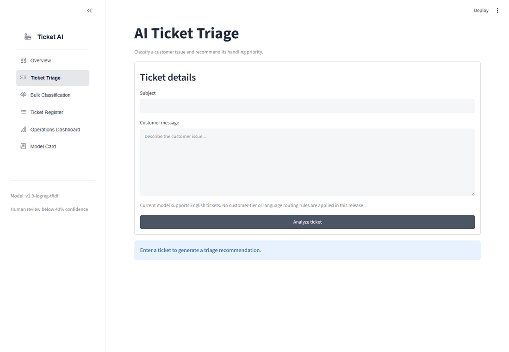

| Ticket Triage | Operations Dashboard |
|---|---|
| 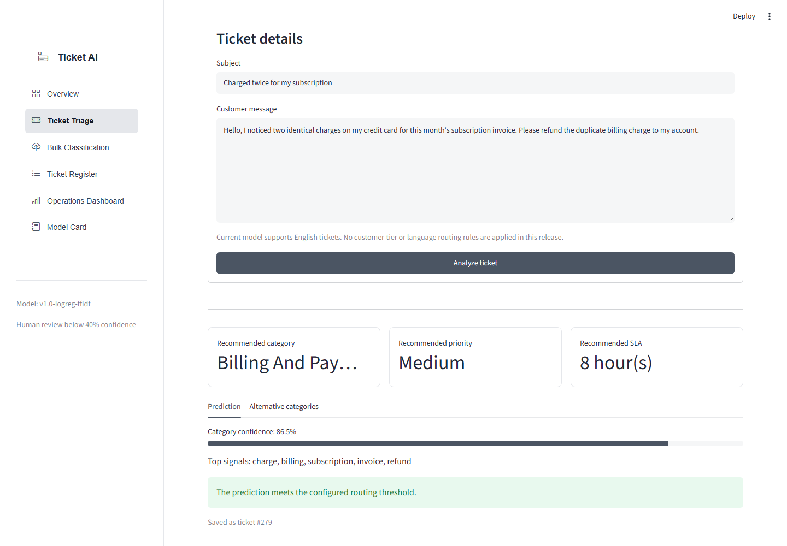 | 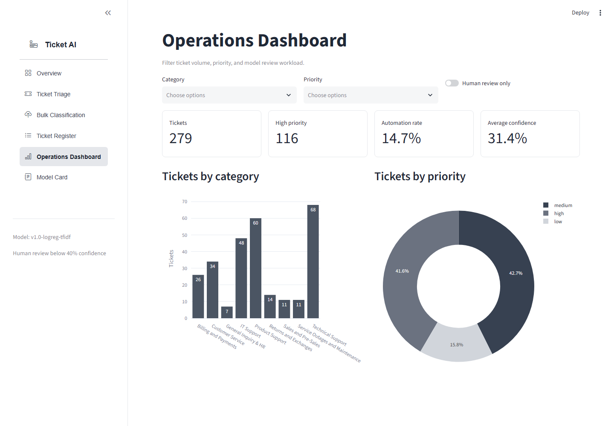 |
| **Bulk Classification + Review Queue** | **Model Card** |
| 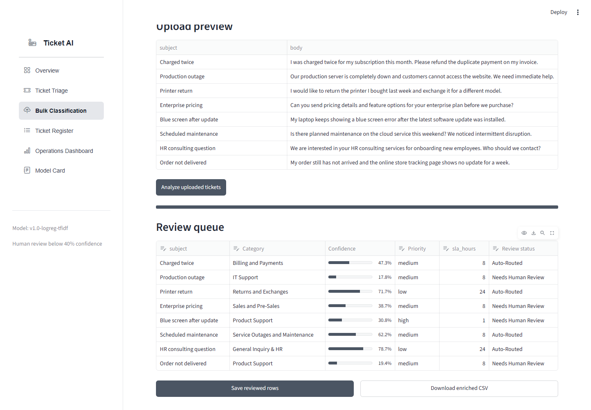 | 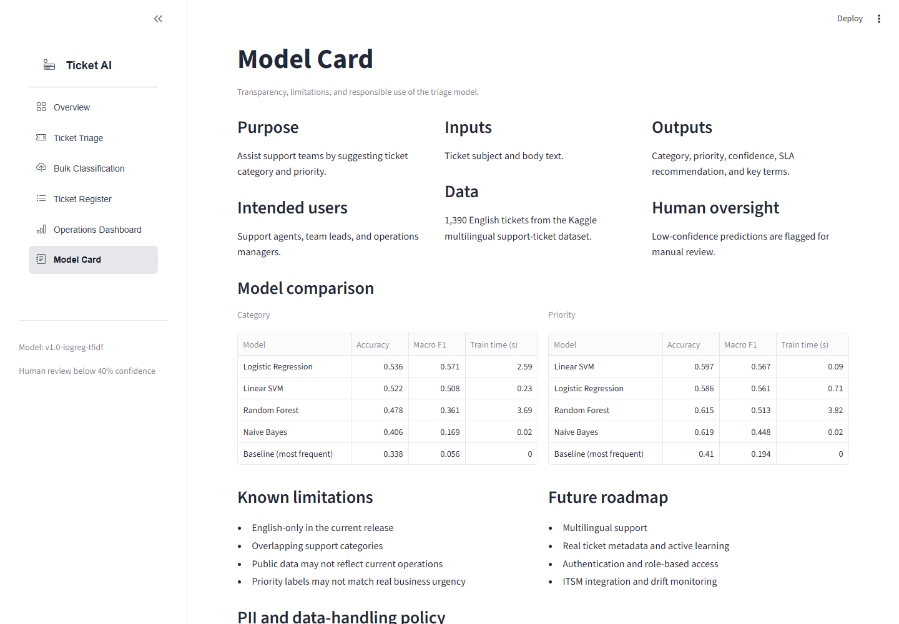 |

<details>
<summary>More screenshots</summary>

**Overview KPIs**

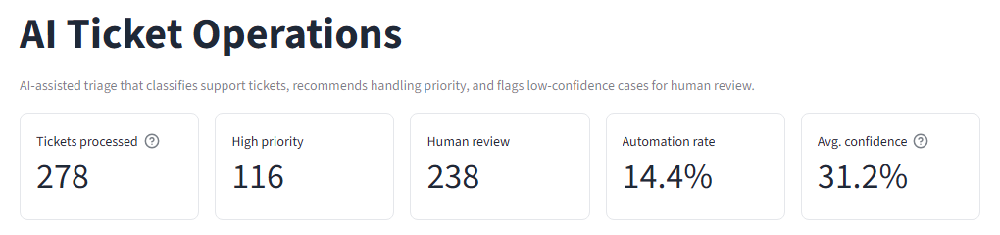

**Ticket Register**

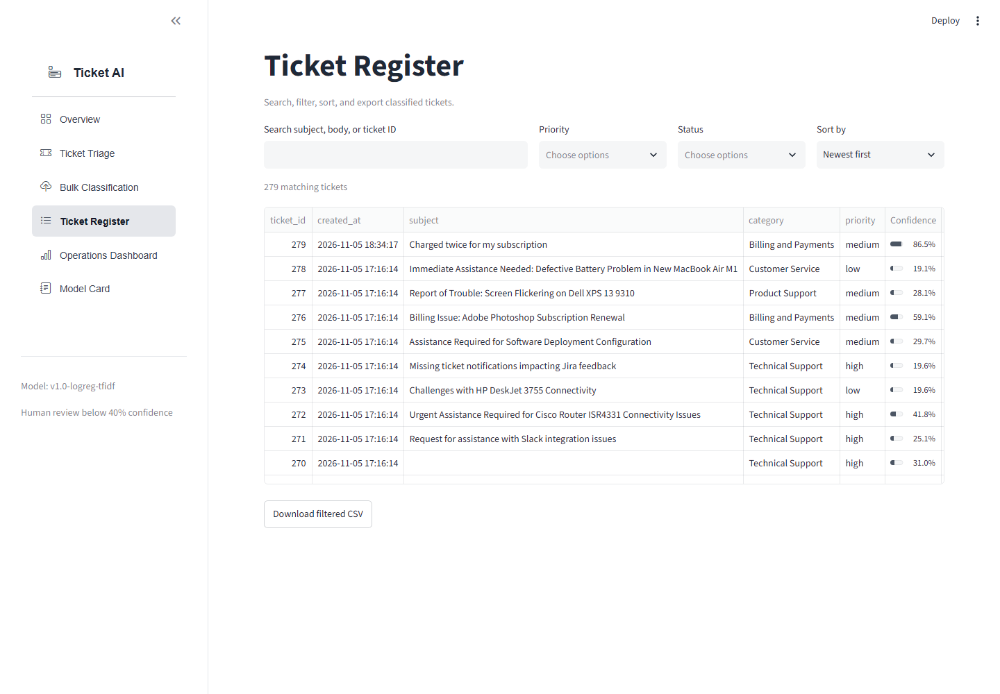

</details>

---

## Business Problem

Support teams receive a high volume of tickets across billing, technical support, returns, service outages and more. Manual triage is slow and inconsistent, and it delays high-impact issues: an urgent outage can wait in the same queue as a pricing question.

This project demonstrates an AI-assisted triage workflow that:

- Predicts the most likely **support department** for a ticket
- Predicts its **priority** (high / medium / low)
- Recommends an **SLA** response window
- **Explains** the terms that drove the prediction
- **Flags uncertain predictions** for a human instead of silently mis-routing them
- **Stores** every ticket and prediction for operational reporting

> **Headline result:** with a 40% confidence threshold, the system auto-routes **14.4%** of held-out tickets at **92.5% accuracy** and sends the rest to human review. With no threshold it routes everything at 51.4%. The threshold is the lever between automation and accuracy (see [Confidence-aware routing](#confidence-aware-routing)).

---

## Key Features

- **Ticket triage:** predicts category and priority from the ticket subject and body.
- **Explainability:** shows the top TF-IDF terms pushing the ticket toward its predicted category (TF-IDF weight × model coefficient).
- **Confidence-aware routing:** predictions below a configurable threshold are marked *Needs Human Review*.
- **SLA recommendation:** maps priority to a response window (high = 1 h, medium = 8 h, low = 24 h).
- **Bulk classification:** upload a CSV, review and edit predictions in a table, then export or save to SQL.
- **Ticket register:** search, filter, sort and export every classified ticket.
- **Operations dashboard:** volume, priority mix, automation rate and review workload, with filters.
- **Input validation and PII masking:** rejects empty, too-short or oversized tickets; masks emails, phone numbers and long numeric IDs before prediction and storage.
- **SQL persistence:** normalized SQLite schema separating tickets (facts) from predictions (model output).
- **Model card:** intended use, data, evaluation, limitations and data-handling policy, inside the app.

---

## System Architecture

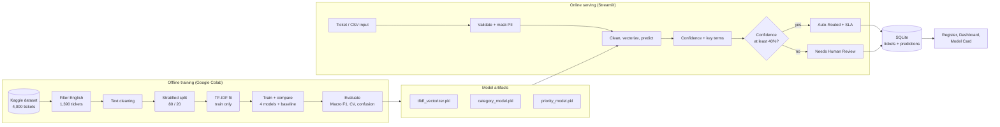

**Request flow for a single ticket:**

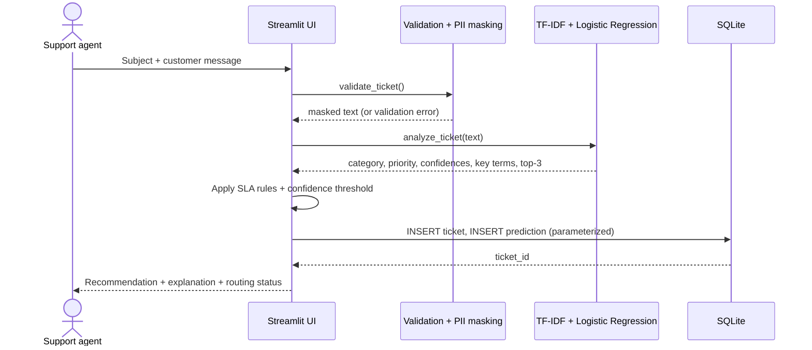

---

## Tech Stack

| Layer | Tools |
|---|---|
| Language | Python |
| Data processing | Pandas, NumPy |
| NLP | NLTK (stopwords, WordNet lemmatizer), TF-IDF |
| Machine learning | scikit-learn (Logistic Regression, Linear SVM, Random Forest, Naive Bayes) |
| Evaluation | Accuracy, precision, recall, macro F1, confusion matrix, 5-fold cross-validation |
| Database | SQLite |
| Visualization | Plotly |
| Application | Streamlit, streamlit-option-menu |
| Testing | pytest, Streamlit `AppTest` |
| Version control | Git / GitHub |

---

## Dataset

- **Source:** [Multilingual Customer Support Tickets (Kaggle, Tobi Bueck)](https://www.kaggle.com/datasets/tobiasbueck/multilingual-customer-support-tickets), file `dataset-tickets-multi-lang3-4k.csv`
- **Original size:** 4,000 tickets × 17 columns. Languages: English 1,391 · German 848 · Spanish 812 · French 476 · Portuguese 473
- **Version used:** English subset only
- **Final modeling data:** 1,390 English tickets (1 empty-body row removed; 0 duplicates)
- **Input features:** `subject` + `body`, joined into one text field
- **Category target:** `queue`, 9 support departments after merging rare classes
- **Priority target:** `priority` (`high` 595, `medium` 557, `low` 239)
- **Excluded fields:** `answer`, `tag_1`–`tag_9`, `business_type`, `language`

The `answer` field was excluded because it is the agent's reply, which does not exist when a new ticket arrives. Using it would be **data leakage**.

<details>
<summary>Category distribution (English subset)</summary>

| Category | Tickets |
|---|---:|
| Technical Support | 468 |
| Product Support | 234 |
| Customer Service | 213 |
| IT Support | 167 |
| Billing and Payments | 120 |
| Returns and Exchanges | 65 |
| Service Outages and Maintenance | 51 |
| Sales and Pre-Sales | 42 |
| General Inquiry & HR *(merged: 15 + 15)* | 30 |

</details>

---

## ML Pipeline

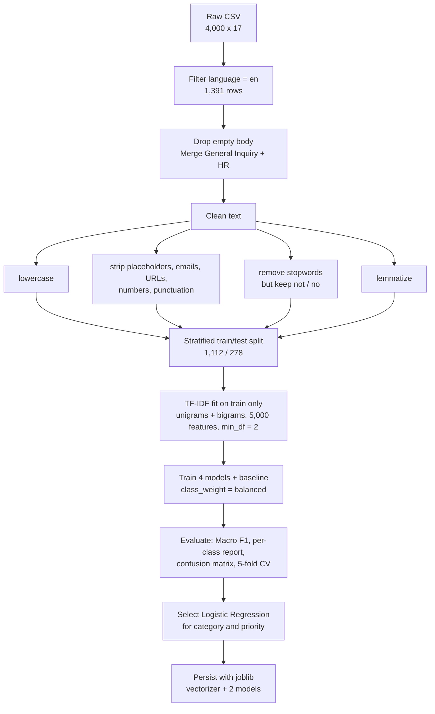

### Key design decisions

| Decision | Why |
|---|---|
| **English only** | TF-IDF is vocabulary-based. Mixing 5 languages splits each concept ("urgent" / "dringend" / "urgente") into unrelated features. |
| **Merge General Inquiry + HR** | 15 tickets each would leave about 3 test examples per class, which is too few for a reliable score. |
| **Keep "not" and "no"** | "payment not working" and "payment working" must not collapse to the same text. |
| **Split before TF-IDF** | IDF statistics must come only from training data, otherwise test information leaks into the features. |
| **Macro F1 as primary metric** | Classes are imbalanced. Accuracy rewards ignoring small classes (see the Naive Bayes result below). |
| **Logistic Regression for both targets** | Best category F1. For priority it is within 0.006 of Linear SVM, a statistical tie on 278 tickets, and it provides `predict_proba` (confidence routing) and readable coefficients (explanations). |
| **Human-review threshold** | Turns a 51%-accurate classifier into a system that is about 92% accurate on what it auto-routes. |

---

## Model Performance

All scores are on the 278-ticket held-out test set. Every real model is compared against a **most-frequent baseline**.

### Category classification (9 classes)

| Model | Accuracy | Macro F1 | Train time (s) |
|---|---:|---:|---:|
| **Logistic Regression** | 0.536 | **0.571** | 2.59 |
| Linear SVM | 0.522 | 0.508 | 0.23 |
| Random Forest | 0.478 | 0.361 | 3.69 |
| Multinomial Naive Bayes | 0.406 | 0.169 | 0.02 |
| Most-frequent baseline | 0.338 | 0.056 | 0.00 |

### Priority prediction (3 classes)

| Model | Accuracy | Macro F1 | Train time (s) |
|---|---:|---:|---:|
| Linear SVM | 0.597 | **0.567** | 0.09 |
| **Logistic Regression** *(selected)* | 0.586 | 0.561 | 0.71 |
| Random Forest | 0.615 | 0.513 | 3.82 |
| Multinomial Naive Bayes | 0.619 | 0.448 | 0.02 |
| Most-frequent baseline | 0.410 | 0.194 | 0.00 |

> **The accuracy trap:** Naive Bayes has the *highest* priority accuracy (0.619) but the *lowest* real-model Macro F1 (0.448), because it almost never predicts `low`. This is why Macro F1, not accuracy, drives model selection.

### Accuracy per category

Calculated in SQL ([`sql/queries.sql`](sql/queries.sql), query 5) from the predictions stored for the held-out tickets in `tickets.db`:

| Category | Test tickets | Accuracy |
|---|---:|---:|
| Service Outages and Maintenance | 10 | 90.0% |
| Billing and Payments | 24 | 83.3% |
| Sales and Pre-Sales | 8 | 75.0% |
| Returns and Exchanges | 13 | 69.2% |
| Product Support | 47 | 57.4% |
| Technical Support | 94 | 43.6% |
| Customer Service | 43 | 39.5% |
| IT Support | 33 | 36.4% |
| General Inquiry & HR | 6 | 33.3% *(small sample)* |

### Confidence-aware routing

| Confidence threshold | Tickets auto-routed | Accuracy on auto-routed |
|---:|---:|---:|
| none | 100.0% | 51.4% |
| 30% | 38.1% | 66.0% |
| **40% (deployed)** | **14.4%** | **92.5%** |
| 50% | 8.3% | 95.7% |

**Priority safety check:** 10 of 114 truly high-priority test tickets (8.8%) were predicted as `low`. That is the costliest error type, and it is tracked as SQL query 7.

### Interpretation

Specialized departments (Service Outages, Billing, Sales, Returns) score 69–90% because their tickets contain distinctive vocabulary such as *outage*, *invoice*, *pricing* and *exchange*. Technical Support, IT Support and Customer Service are hard to separate because their tickets share generic language (*issue*, *service*, *aws*). The model's confusion mirrors a real ambiguity in how these departments are defined. In practice they could be merged into one queue, or left to the human-review path, which is exactly where the confidence threshold sends them.

The selected Logistic Regression models provide calibrated-enough probability estimates and interpretable coefficients. Together these support confidence-based routing and per-ticket explanations.

> Stored predictions in `tickets.db` give 51.4% category accuracy versus 53.6% in the comparison table. The difference comes from a preprocessing iteration (refined stopword list) between the two notebook runs.

---

## Installation

### Prerequisites

- Python **3.10–3.13** (the model artifacts were trained with scikit-learn 1.6.1, which provides wheels up to Python 3.13)
- Git

### Setup

```bash
git clone https://github.com/sidhantds/ai-ticket-triage.git
cd ai-ticket-triage

python -m venv .venv

# Windows
.venv\Scripts\activate

# macOS / Linux
source .venv/bin/activate

pip install -r requirements.txt
```

NLTK stopwords and WordNet data download automatically on first launch.

### Run the application

```bash
streamlit run app.py
```

Then open the local URL shown in the terminal, usually `http://localhost:8501`.

The repository ships with `tickets.db` pre-loaded with the 278 held-out test tickets and their predictions, so the dashboard and register have data immediately.

---

## Usage

### Analyze a single ticket

1. Open **Ticket Triage**.
2. Enter the subject and customer message.
3. Click **Analyze ticket**.
4. Review the recommended category, priority, SLA, confidence, top signals and alternative categories.
5. The ticket and prediction are saved automatically and appear in the **Ticket Register**.

### Bulk classification

1. Open **Bulk Classification**.
2. Upload a CSV with a `body` column and an optional `subject` column. Try [`data/sample_tickets.csv`](data/sample_tickets.csv).
3. Click **Analyze uploaded tickets**.
4. Correct any category, priority or status in the editable review queue.
5. **Download enriched CSV** or **Save reviewed rows** to the database.

### Example

**Input**

```text
Subject: Charged twice for my subscription
Body:    Hello, I noticed two identical charges on my credit card for this month's
         subscription invoice. Please refund the duplicate billing charge to my account.
```

**Output** (actual app output, shown in the screenshot above)

```text
Recommended category : Billing and Payments   (86.5% confidence)
Recommended priority : Medium
Recommended SLA      : 8 hour(s)
Top signals          : charge, billing, subscription, invoice, refund
Routing status       : Auto-Routed (meets the 40% threshold)
```

---

## Project Structure

```text
.
├── app.py                          # Streamlit application (6 pages)
├── requirements.txt                # Runtime dependencies
├── requirements-dev.txt            # Test dependencies
├── .streamlit/
│   └── config.toml                 # Neutral light theme
├── tfidf_vectorizer.pkl            # Fitted TF-IDF vectorizer (5,000 features)
├── category_model.pkl              # Logistic Regression - department
├── priority_model.pkl              # Logistic Regression - priority
├── model_comparison_category.csv   # Model comparison results
├── model_comparison_priority.csv
├── tickets.db                      # SQLite demo database (278 held-out tickets)
├── data/
│   └── sample_tickets.csv          # Sample input for bulk classification
├── sql/
│   ├── schema.sql                  # Table definitions
│   └── queries.sql                 # 7 analytical queries
├── tests/
│   └── test_app.py                 # pytest + Streamlit AppTest suite
├── docs/
│   ├── demo.gif
│   └── screenshots/
├── LICENSE
└── README.md
```

---

## SQL Database Design

The application uses SQLite with two related tables. **Tickets are facts; predictions are model opinions.** Keeping them apart lets a retrained model add new predictions without rewriting ticket history, and `model_version` records which model produced each prediction.

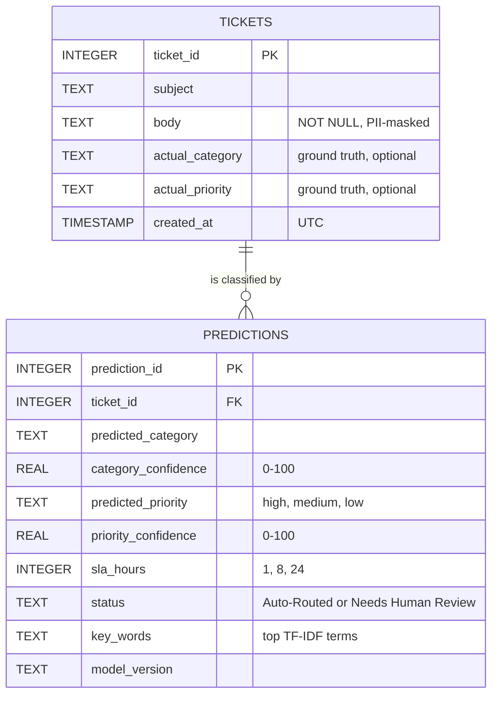

All writes use parameterized queries (`?` placeholders), so ticket text is always treated as data and never as SQL. [`sql/queries.sql`](sql/queries.sql) contains the analytical queries:

| # | Business question | SQL concepts |
|---|---|---|
| 1 | Ticket volume per department | `GROUP BY`, `COUNT` |
| 2 | Priority mix and average confidence | `AVG`, `ROUND` |
| 3 | Automation rate | Subquery for percentage |
| 4 | Supervisor queue: urgent tickets needing a human | `JOIN`, `WHERE`, `ORDER BY` |
| 5 | Model accuracy per category | `CASE WHEN` inside `SUM` |
| 6 | Workload matrix (category × priority) | Conditional aggregation |
| 7 | Dangerous mistakes (high predicted as low) | `JOIN` + filtered `COUNT` |

---

## Responsible AI and Limitations

- **English only.** Tickets in other languages will be misclassified, not rejected.
- **Public data.** The Kaggle dataset may not reflect real enterprise ticket distributions or wording. Product names (e.g. *AWS*) recur across departments.
- **Overlapping categories.** Technical Support, IT Support and Customer Service are frequently confused (36–44% accuracy).
- **Priority labels** may not match real business urgency or customer impact. 8.8% of high-priority tickets were predicted as low.
- **Decision support, not decision making.** Predictions are recommendations, and low-confidence cases go to a human.
- **PII masking is pattern-based.** It catches emails, phone numbers and long numeric IDs, but not names, addresses or free-form identifiers.
- **Prototype scope.** There is no authentication, role-based access control, audit log or production monitoring.

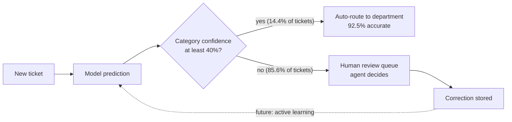

---

## Production Roadmap

| Area | Current prototype | Production target |
|---|---|---|
| Interface | Streamlit app | Authenticated internal web application |
| Database | SQLite | PostgreSQL / enterprise database |
| Authentication | None | SSO and role-based access control |
| Model serving | Local `.pkl` artifacts | Versioned model registry + inference API |
| Data | Public Kaggle dataset | Approved enterprise ticket data |
| Languages | English | Multilingual (translation or multilingual embeddings) |
| Model | TF-IDF + Logistic Regression | Transformer embeddings benchmark against the current baseline |
| Monitoring | Manual dashboard | Drift, latency, accuracy and fairness monitoring |
| Integration | Standalone app | ITSM / ticketing-system API integration |
| Feedback loop | Manual review flag | Agent corrections feeding active learning and retraining |

---

## Testing

```bash
pip install -r requirements-dev.txt
pytest -v
```

The suite has 13 tests covering:

- **Application startup** with Streamlit's headless `AppTest` (no exceptions, page renders)
- **Text cleaning:** noise removal, placeholders, URLs and numbers, and negation preserved
- **PII masking** of emails, phone numbers and long IDs
- **Input validation:** empty, whitespace-only, too-short and oversized tickets are rejected
- **SLA mapping**
- **Prediction output schema:** keys, valid labels, confidence range, sorted top-3
- **Routing rule:** status matches the confidence threshold
- **Behavioural check:** a clear billing ticket routes to *Billing and Payments*

---

## Author

**Siddhant Pujara**
AI/ML Intern | Hitachi Digital
[GitHub @sidhantds](https://github.com/sidhantds)

### Acknowledgements

- Dataset: [Tobi Bueck, Multilingual Customer Support Tickets](https://www.kaggle.com/datasets/tobiasbueck/multilingual-customer-support-tickets) (Kaggle)
- Built with [Streamlit](https://streamlit.io), [scikit-learn](https://scikit-learn.org), [NLTK](https://www.nltk.org) and [Plotly](https://plotly.com)

## License

This project is licensed under the MIT License. See [`LICENSE`](LICENSE) for details.
